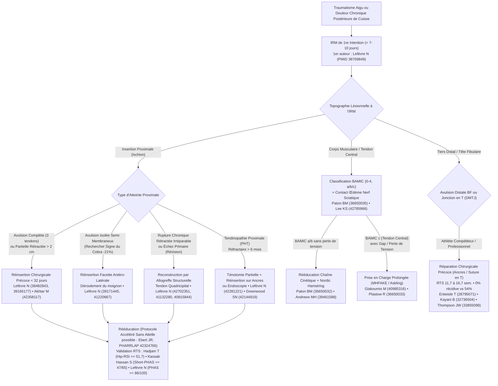

# Revue de la Littérature : Pathologie, Imagerie, Chirurgie et Rééducation des Ischio-Jambiers
**Synthèse Académique Exhaustive des 32 Publications de Référence du Portail [BiblioIschio](file:///Users/docteurlefevrenicolas/.gemini/antigravity/scratch/biblio-ischio/index.html) (2017–2026)**

> [!IMPORTANT]
> **📌 Messages Clés Transversaux — Synthèse par 1er Auteur (32 études • > 4 200 patients analysés)**
> 1. **Urgence diagnostique IRM (👤 1er auteur : Lefèvre N, *KSSTA* 2024) :** Prescrire une IRM d'emblée plutôt qu'une échographie réduit de **10 jours** le délai opératoire médian (20 j vs 30 j) et améliore significativement les scores sportifs Tegner et UCLA à long terme ([PMID 38769849](https://pubmed.ncbi.nlm.nih.gov/38769849/)).
> 2. **Seuil critique de chronicité à 32 jours (👤 1er auteur : Lefèvre N, *AJSM* 2024 & 👤 1er auteur : Akhtar M, *AJSM* 2026) :** Au-delà de **32 jours** entre l'accident et la chirurgie, le risque de re-rupture est multiplié par **2,5** (`HR = 2,50`, $p = 0,01$) ([PMID 38482843](https://pubmed.ncbi.nlm.nih.gov/38482843/)). À l'échelle méta-analytique ($n = 1\,720$), opérer avant 4 à 6 semaines réduit de **74 %** le risque de sciatalgie post-opératoire (`RR = 0,26`) et de **49 %** le risque de re-rupture (`RR = 0,51`) ([PMID 42358117](https://pubmed.ncbi.nlm.nih.gov/42358117/)).
> 3. **Supériorité démontrée de la chirurgie & suivi $\ge$ 10 ans (👤 1er auteur : Lefèvre N, *AJSM* 2024 & *OJSM* 2026) :** À plus de 4 ans de recul en analyse appariée, la réinsertion chirurgicale multiplie par **6** (`OR = 6,04`) la probabilité de reprendre le sport au niveau antérieur (67,7 % vs 26,7 %) avec **89,5 %** de satisfaction contre **25 %** sous traitement conservateur ([PMID 39165177](https://pubmed.ncbi.nlm.nih.gov/39165177/)), et un score PHAS qui continue de progresser jusqu'à **8 ans** post-opératoires (PHAS = 87,5 à > 10 ans, [PMID 41685043](https://pubmed.ncbi.nlm.nih.gov/41685043/)).
> 4. **Sémiologie IRM — « Signe du Cobra » & Remodelage 3T (👤 1er auteur : Lefèvre N, *KSSTA* 2025 & 👤 1er auteur : Mechó S, *Skeletal Radiol* 2026) :** Le **« Signe du Cobra »** possède une spécificité de **83,3 %** pour l'avulsion isolée du semi-membraneux et surestime de **21 % (2,0 cm)** la rétraction réelle ([PMID 39171445](https://pubmed.ncbi.nlm.nih.gov/39171445/)), tandis qu'à 4 mois post-opératoires ~40 % des tendons guéris gardent une fente IRM 3T bénigne ([PMID 42963497](https://pubmed.ncbi.nlm.nih.gov/42963497/)).
> 5. **Allogreffes chroniques, PHT & Endoscopie (👤 1er auteur : Lefèvre N, *Arthroscopy* / *AJSM* 2026 & 👤 1er auteur : Greenwood SN, 2026) :** L'allogreffe structurelle fait passer le PHAS médian de **56,3 à 84,5** dans les rétractions chroniques irréparables ([PMID 42702351](https://pubmed.ncbi.nlm.nih.gov/42702351/)) ; la ténotomie-réinsertion sur ancres (PHAS de 63,0 à **84,2**, [PMID 42281221](https://pubmed.ncbi.nlm.nih.gov/42281221/)) et l'endoscopie à 7,6 ans (**86,4 %** de satisfaction, [PMID 42144919](https://pubmed.ncbi.nlm.nih.gov/42144919/)) traitent durablement les PHT et lésions partielles.
> 6. **Lésions distales & Jonction en T du biceps fémoral (👤 1er auteur : Entwisle T, 2017 • 👤 Kayani B, 2020 • 👤 Thompson JW, 2021) :** La jonction en T (DMTJ) récidive dans **54 %** des cas sans chirurgie ([PMID 28795071](https://pubmed.ncbi.nlm.nih.gov/28795071/)), contre **0 % de récidive et 100 % de retour au niveau pro** après réparation chirurgicale précoce ([PMID 32736504](https://pubmed.ncbi.nlm.nih.gov/32736504/), [PMID 33855098](https://pubmed.ncbi.nlm.nih.gov/33855098/)).
> 7. **Scores RTS, Rééducation sans attelle & Sarcomères (👤 1er auteur : Lefèvre N • 👤 Kassab Hassan S • 👤 Hadjam T • 👤 Ebert JR • 👤 Andrews MH) :** Validation RTS par `Hip-RSI >= 51,7` à M4 ([PMID 41306750](https://pubmed.ncbi.nlm.nih.gov/41306750/)), `Short-PHAS >= 47/65` à M8 ([PMID 42169801](https://pubmed.ncbi.nlm.nih.gov/42169801/)) et `PHAS >= 86/100` à M9 ([PMID 38353118](https://pubmed.ncbi.nlm.nih.gov/38353118/)), appui immédiat sans attelle validé en Niveau I ([PMID 42324766](https://pubmed.ncbi.nlm.nih.gov/42324766/)) et **+49 % de sarcomères en série** après 9 semaines de Nordic Hamstring ([PMID 39461588](https://pubmed.ncbi.nlm.nih.gov/39461588/)).

---

## 🧭 Algorithme Décisionnel Intégré (Basé sur les 32 études)

---

## 1. Parcours Diagnostique, Sémiologie IRM et Classifications (6 études)

Le complexe musculo-tendineux des ischio-jambiers — composé du chef long du biceps fémoral (BFlh) et du semi-tendineux (ST) formant le tendon conjoint médial/superficiel, et du semi-membraneux (SM) s'insérant sur la facette antéro-latérale en croissant de la tubérosité ischiatique — possède une vulnérabilité biomécanique unique liée à son action bi-articulaire (extension de hanche et flexion de genou) et à son rapport intime avec le nerf sciatique. Les six publications de ce premier axe redéfinissent l'ensemble de la chaîne diagnostique.

### 1.1. L'IRM en première intention : bannir l'échographie isolée initiale (👤 1er auteur : Lefèvre N, *KSSTA* 2024 — [PMID 38769849](https://pubmed.ncbi.nlm.nih.gov/38769849/))
Dans une étude de cohorte portant sur **392 patients** opérés d'une avulsion proximale des ischio-jambiers entre 2012 et 2020, **Lefèvre N et al.** ont comparé l'impact pronostique du parcours débutant par une échographie (*US-first*) à celui débutant directement par une IRM (*MRI-first*). En raison de la profondeur de la tubérosité ischiatique sous le muscle grand fessier et du volume de l'hématome aigu, l'échographie initiale est fréquemment faussement rassurante ou imprécise, imposant une IRM secondaire qui retarde toute la filière de soins. Les résultats démontrent que prescrire une IRM d'emblée réduit de **10 jours** le délai médian entre l'accident et l'intervention chirurgicale : **20,0 jours** (`IQR 11–61`) dans le groupe IRM première contre **30,0 jours** (`IQR 18–74`) après échographie initiale. Ce gain de 10 jours maintient les patients en deçà du seuil critique de 32 jours et se traduit, à plus de 4 ans de recul, par des scores d'activité sportive **Tegner** (médiane 5 vs 4) et **UCLA** significativement supérieurs.

### 1.2. Le « Signe du Cobra » en IRM : un marqueur spécifique de surestimation de la rétraction du semi-membraneux (👤 1er auteur : Lefèvre N, *KSSTA* 2025 — [PMID 39171445](https://pubmed.ncbi.nlm.nih.gov/39171445/))
L'estimation radiologique de la rétraction tendineuse conditionne le choix entre une réinsertion primaire directe et une reconstruction par allogreffe. Sur une série consécutive de **81 avulsions proximales opérées**, **Lefèvre N et al.** ont décrit et validé un nouveau signe sémiologique sur les coupes coronales et sagittales T2/DP-FatSat : le **« Signe du Cobra »**. Il correspond à un tendon proximal rétracté dessinant une bande hypo-intense ondulée dont l'extrémité libre se replie distalement sur elle-même, évoquant la silhouette d'une tête de cobra dressée. Identifié chez 25 patients à l'IRM, ce signe correspondait chirurgicalement dans 100 % des cas confirmés à une avulsion du **tendon semi-membraneux**, avec une **spécificité de 83,3 %** (sensibilité 51,5 %, rapport de vraisemblance positif `LR+ = 3,0`). En pratique chirurgicale, la mesure radiologique prise au sommet de la courbure surestime la rétraction réelle de **21 %** : la distance mesurée en IRM est de **10,05 ± 3,0 cm** alors que la rétraction réelle mesurée en per-opératoire après déroulement du moignon tendineux n'est que de **7,9 ± 2,5 cm** (différence moyenne de **2,0 cm**, $p < 0,001$). Reconnaître le Signe du Cobra permet donc au chirurgien de savoir qu'il dispose de 2 cm supplémentaires de longueur tendineuse après déplissement et d'éviter de récuser à tort une réinsertion anatomique directe.

### 1.3. Sémiologie IRM pré-opératoire standardisée et cinétique IRM 3T de la cicatrisation post-opératoire (👤 1er auteur : Weber MA, *Skeletal Radiol* 2026 — [PMID 42530617](https://pubmed.ncbi.nlm.nih.gov/42530617/) & 👤 1er auteur : Mechó S, *Skeletal Radiol* 2026 — [PMID 42963497](https://pubmed.ncbi.nlm.nih.gov/42963497/))
- **Sémiologie selon le mécanisme traumatique (Weber MA et al., 2026) :** Oppose biomécaniquement le **sprint à haute vélocité** en fin de phase d'oscillation (qui lèse préférentiellement la jonction myo-tendineuse et l'aponévrose centrale du chef long du biceps fémoral) et l'**étirement forcé (*overstretch*)** associant hyperflexion de hanche et extension de genou (ski nautique, grand écart, glissade, chute au rugby, qui arrache préférentiellement le tendon libre proximal du semi-membraneux ou l'empreinte ischiatique complète).
- **Cinétique IRM 3T post-opératoire (Mechó S, Lempainen L, Kassarjian A et al., 2026 — FC Barcelone) :** Analyse longitudinale de **43 IRM 3 Tesla** réalisées au cours des 4 premiers mois suivant une réparation chirurgicale complète chez **20 footballeurs professionnels**. Chez les joueurs ayant une évolution clinique normale, l'IRM montre quasi constamment des fentes intra-tendineuses longitudinales (**73,3 %**) et transversales (**86,7 %**), une angulation tendineuse (**100 %**), un contour musculaire émoussé (**86,7 %**) et un pseudo-œdème de dénervation musculaire (**66,7 %**). À 4 mois, bien que la cicatrice fibreuse devienne mature en hyposignal dans 100 % des cas, des fentes intra-tendineuses résiduelles persistent chez **~40 % des athlètes asymptomatiques**. Il ne faut donc jamais retarder la reprise sportive sur la seule présence d'une fente linéaire résiduelle au sein d'un cal mature ; seule la triade « fente large + cavité liquide en franc hypersignal DP-FS + cicatrice immature » annonce une rechute clinique.

### 1.4. Consensus International de Londres (Partie 1) et valeur pronostique de la classe BAMIC *c* (👤 1er auteur : Paton BM, *BJSM* 2023 — [PMID 36650035](https://pubmed.ncbi.nlm.nih.gov/36650035/) & 👤 1er auteur : Giakoumis M, *Scand J Med Sci Sports* 2025 — [PMID 40985316](https://pubmed.ncbi.nlm.nih.gov/40985316/))
- **Consensus de Londres Partie 1 (Paton BM, Haddad FS et al., 2023) :** Mené par méthode Delphi auprès de **112 experts internationaux** (88,4 % de réponse), il établit que la classification **BAMIC** (*British Athletics Muscle Injury Classification*, grades 0 à 4 associés à la localisation anatomique : *a* myofasciale, *b* jonction myo-tendineuse, *c* tendon intra-musculaire) est le système le plus utilisé au monde (**58 %** des experts, contre 12 % pour Munich et 6 % pour Barcelone). Le panel recommande d'y adjoindre systématiquement le muscle exact atteint, le niveau topographique et la perte de tension (*loss of tension*).
- **Spécificité clinique des lésions BAMIC *c* (Giakoumis M, Pollock N et al., 2025) :** Chez les athlètes d'élite de *British Athletics*, **30 %** des lésions aiguës sont précédées dans les 7 jours par des prodromes (raideurs lombaires ou crampes postérieures). Les lésions du tendon central (**BAMIC classe *c***) entraînent une douleur significativement plus élevée à la marche et à la contraction isométrique et retardent la reprise du footing indolore ($p = 0,04$). Surtout, le délai de disparition de la douleur à la palpation directe ($p = 0,69$) ou dans les gestes quotidiens ($p = 0,30$) **ne prédit aucunement** la durée totale de rééducation, alors que les tests de mise en tension active en course externe — le test d'extension active du genou à flexion maximale de hanche (**MHFAKE**, $p = 0,01$) et le **H-test d'Askling** — sont hautement prédictifs du retour à l'entraînement complet.

---

## 2. Ruptures Proximales Aiguës : Indications, Délai Optimal et Résultats de la Cohorte PHAS (7 études)

Les avulsions proximales des ischio-jambiers (PHAI) représentent la forme la plus sévère des lésions postérieures de la cuisse. Leur prise en charge a été codifiée par les travaux prospectifs de la **cohorte parisienne PHAS** (*Proximal Hamstring Avulsion Surgery*, **Dr Nicolas Lefèvre**, Clinique du Sport Paris, NCT02906865) portant sur plus de 750 patients opérés et corroborés par la méta-analyse internationale de 2026 sur 1 720 réparations.

| 1er Auteur & Revue | PMID | Effectif & Design | Recul Moyen | Principaux Résultats Chiffrés |
| :--- | :--- | :--- | :--- | :--- |
| **👤 Lefèvre N** (*OJSM*, 2026) | [`41918719`](https://pubmed.ncbi.nlm.nih.gov/41918719/) | $n = 757$ • Cohorte prospective PHAS | Suivi prospectif | Complications globales **10,4 %** (**5,6 %** re-ruptures, **4,7 %** hors re-rupture) ; **75 %** < 5,5 mois ; FdR : AT (`OR = 5,59`), SM isolé (`OR = 12,1`). |
| **👤 Lefèvre N** (*OJSM*, 2026) | [`41685043`](https://pubmed.ncbi.nlm.nih.gov/41685043/) | $n = 139$ • Cohorte prospective (Niveau II) | **123,4 mois** (> 10 ans, min 8 ans) | **PHAS = 87,5 ± 14,9** ; UCLA de 3,1 à **7,5** ; amélioration continue du PHAS jusqu'à 8 ans ; chirurgie chronique (> 4 sem.) : **OR ~6** de mauvais PHAS. |
| **👤 Akhtar M** (*AJSM*, 2026) | [`42358117`](https://pubmed.ncbi.nlm.nih.gov/42358117/) | $n = 1\,720$ (12 études : 992 précoces vs 728 différées) | 24 à 58,8 mois | Chirurgie précoce ($\le$ 4–6 sem.) : réduction des **sciatalgies (`RR = 0,26`, $p = 0,009$)** et des **re-ruptures (`RR = 0,51`, $p = 0,03$)**. |
| **👤 Lefèvre N** (*KSSTA*, 2025) | [`39844676`](https://pubmed.ncbi.nlm.nih.gov/39844676/) | $n = 298$ appariés (< 50 ans vs > 50 ans) | 4,7 et 4,1 ans | Gain fonctionnel significatif avant (41,8 ans) et après 50 ans (58,0 ans) ; taux de complications et de retour au sport **identiques** ($p > 0,05$). |
| **👤 Lefèvre N** (*AJSM*, 2024) | [`39165177`](https://pubmed.ncbi.nlm.nih.gov/39165177/) | $n = 127$ appariés (95 opérés vs 32 non opérés) | > 4 ans (50,7 vs 56,5 mois) | **PHAS 86,3 vs 69,8** ; RTS même niveau **67,7 % vs 26,7 % (`OR = 6,04`)** ; satisfaction **89,5 % vs 25 %**. |
| **👤 Lefèvre N** (*AJSM*, 2024) | [`38482843`](https://pubmed.ncbi.nlm.nih.gov/38482843/) | $n = 740$ • Cohorte PHAS | 4,9 ± 3,9 ans | Taux de re-rupture **4,59 %** (médiane 88,5 j, 74 % atraumatiques) ; **seuil ROC optimal = 32 jours (`HR = 2,50`)** ; rupture complète initiale (`HR = 4,33`). |
| **👤 Lefèvre N** (*AJSM*, 2024) | [`38353018`](https://pubmed.ncbi.nlm.nih.gov/38353018/) | $n = 64$ athlètes professionnels | Série prospective | **RTS global = 98,4 %** ; RTS au niveau pro antérieur = **78,1 % à 6,2 ± 2,5 mois** (football 95,2 %, handball/escrime 100 %). |

### 2.1. Supériorité démontrée de la chirurgie sur le traitement conservateur (👤 1er auteur : Lefèvre N, *AJSM* 2024 — [PMID 39165177](https://pubmed.ncbi.nlm.nih.gov/39165177/))
Dans une étude comparative appariée par score de propension avec plus de 4 ans de recul moyen (50,7 vs 56,5 mois) portant sur **127 patients** ayant tous une indication théorique de réparation (avulsion complète des 3 tendons ou avulsion partielle rétractée $> 2\text{ cm}$ : **95 opérés vs 32 ayant refusé la chirurgie**), la réinsertion chirurgicale par ancres surclasse le traitement fonctionnel sur l'ensemble des critères objectifs et subjectifs : le score **PHAS atteint 86,3 ± 12,1 vs 69,8 ± 17,9** ($p < 0,001$), le score UCLA 7,6 vs 5,7 ($p < 0,001$), et le score Tegner 4,6 vs 3,6 ($p = 0,001$). Surtout, la chirurgie multiplie par **6** les chances de retrouver son niveau sportif antérieur (**67,7 % vs 26,7 %** ; `OR = 6,04`, IC 95 % `2,44–16,09`, $p < 0,001$) et procure un taux de satisfaction de **89,5 %** contre seulement **25 %** chez les patients non opérés.

### 2.2. La règle d'or des 32 jours et l'analyse du risque de re-rupture (👤 1er auteur : Lefèvre N, *AJSM* 2024 — [PMID 38482843](https://pubmed.ncbi.nlm.nih.gov/38482843/) & 👤 1er auteur : Akhtar M, *AJSM* 2026 — [PMID 42358117](https://pubmed.ncbi.nlm.nih.gov/42358117/))
Sur une cohorte de **740 patients** opérés d'une réinsertion primaire (suivi moyen 4,9 ± 3,9 ans, **Lefèvre N et al.**), le taux global de re-rupture documentée par IRM est de **4,59 %** (34 cas). L'analyse temporelle révèle que **75 % des re-ruptures surviennent au cours des 6 premiers mois** (délai médian **88,5 jours**, IQR 47–188) et que **74 % (25/34) surviennent de façon atraumatique** lors d'activités banales. En régression de Cox multivariée, deux facteurs prédictifs indépendants dominent : le caractère complet de l'avulsion initiale (`HR = 4,33`, $p = 0,01$) et le délai opératoire. Par analyse de courbe ROC, les auteurs déterminent le **seuil optimal exact de 32 jours** : au-delà de 32 jours entre le traumatisme et l'intervention, le risque de re-rupture est multiplié par **2,5** (`HR = 2,50`, IC 95 % `1,24–5,06`, $p = 0,01$).
Cette frontière est intégralement confirmée par la méta-analyse d'**Akhtar M et al.** (*AJSM* 2026) regroupant 12 études et **1 720 patients** (992 réparations précoces $\le$ 4–6 semaines vs 728 réparations différées) : opérer précocement réduit de **74 % le risque de sciatalgie post-opératoire** (`RR = 0,26`, $p = 0,009$) en évitant la dissection du nerf sciatique dans une gangue fibreuse cicatricielle, et diminue de **49 % le taux de re-rupture** (`RR = 0,51`, $p = 0,03$).

### 2.3. Cartographie des complications sur 757 patients, résultats à > 10 ans et absence de barrière d'âge à 50 ans (👤 1er auteur : Lefèvre N — [PMID 41918719](https://pubmed.ncbi.nlm.nih.gov/41918719/), [PMID 41685043](https://pubmed.ncbi.nlm.nih.gov/41685043/), [PMID 39844676](https://pubmed.ncbi.nlm.nih.gov/39844676/))
- **Complications sur 757 patients (*OJSM* 2026, PMID 41918719) :** Le taux global de complications est de **10,4 %** (79/757), comprenant **5,6 % de re-ruptures** et **4,7 % de complications hors re-rupture** (hématomes, infections superficielles, paresthésies sciatiques ou cutanées postérieures transitoires, thromboses veineuses), dont 75 % surviennent dans les 5,5 premiers mois. Les facteurs de risque indépendants de complications hors re-rupture sont l'accident du travail (`OR = 5,59`, $p = 0,029$) et l'avulsion isolée du semi-membraneux (`OR = 12,1`, $p = 0,020$). Une gêne assise modérée à sévère ne persiste que chez **5 %** de la cohorte.
- **Suivi à très long terme $\ge$ 8 ans (*OJSM* 2026, PMID 41685043) :** Sur **139 patients** suivis en moyenne **123,4 ± 30,8 mois (> 10,3 ans)**, le score PHAS moyen atteint **87,5 ± 14,9** et le score UCLA passe de 3,1 à **7,5**. L'analyse ANOVA longitudinale démontre que le score PHAS continue de progresser significativement entre 1 an, 2 ans, 4 ans, 6 ans et **jusqu'à 8 ans post-opératoires**, tandis qu'une chirurgie tardive (> 4 semaines) multiplie par près de **6** la probabilité d'un mauvais résultat à 10 ans.
- **Comparaison appariée < 50 ans vs > 50 ans (*KSSTA* 2025, PMID 39844676) :** Sur **298 patients appariés** (149 de moins de 50 ans [moyenne 41,8 ans] vs 149 de plus de 50 ans [moyenne 58,0 ans]), les quinquagénaires et sexagénaires obtiennent une amélioration fonctionnelle majeure avec des taux de complications et de retour au sport **strictement identiques** ($p > 0,05$).

### 2.4. Facteurs prédictifs du retour au sport précoce chez l'athlète professionnel (👤 1er auteur : Lefèvre N, *AJSM* 2024 — [PMID 38353018](https://pubmed.ncbi.nlm.nih.gov/38353018/))
Dans une série prospective dédiée à **64 athlètes professionnels** (football, rugby, handball, escrime, danse, arts martiaux ; âge moyen 26,8 ans), **98,4 %** des sportifs ont repris la compétition et **78,1 %** ont retrouvé leur niveau professionnel exact antérieur dans un délai moyen de **6,2 ± 2,5 mois** (retour au niveau pro de **95,2 % chez les footballeurs** et de **100 % au handball et à l'escrime**). L'analyse multivariée révèle que les ruptures complètes du tendon libre proximal respectant l'empreinte osseuse (*negative dropped ice cream sign*, PHTR) récupèrent beaucoup plus rapidement (`HR = 7,77`, $p = 0,02$) que les avulsions tubérositaires vraies détachant l'empreinte osseuse (*positive dropped ice cream sign*).

---

## 3. Ruptures Chroniques, Chirurgie de Révision et Reconstructions par Allogreffe (4 études)

Lorsque le diagnostic initial a été manqué ou après une re-rupture post-opératoire, le moignon tendineux se rétracte distalement dans la loge postérieure et s'entoure d'une fibrose dense englobant le nerf sciatique. Quatre publications de l'équipe parisienne codifient la stratégie chirurgicale face à ces situations complexes.

### 3.1. Chirurgie de révision vs réparation primaire : une chirurgie exigeante à haut risque de re-rupture (👤 1er auteur : Lefèvre N, *AJSM* 2025 — [PMID 40815844](https://pubmed.ncbi.nlm.nih.gov/40815844/))
Dans une étude comparative appariée 1:4 par score de propension (**32 chirurgies de révision comparées à 128 réparations primaires**, suivi moyen ~4 ans), le recours per-opératoire à une greffe de comblement (allogreffe) est **quatre fois plus fréquent en révision qu'en chirurgie primaire (37,5 % vs 9,4 %**, $p = 0,0003$). Lorsque la réparation consolide, les résultats fonctionnels restent très satisfaisants (score PHAS médian de **85,0** en révision contre **91,5** en primaire, $p = 0,01$). Toutefois, le taux de nouvelle re-rupture atteint **31,3 % (10/32)** après révision contre seulement **3,9 % (5/128)** après réparation primaire, soit un risque multiplié par plus de 8 (`HR = 8,19`, IC 95 % `2,76–24,3`).

### 3.2. Reconstruction par allogreffe structurelle des avulsions chroniques irréparables (👤 1er auteur : Lefèvre N, *Arthroscopy* 2026 — [PMID 42702351](https://pubmed.ncbi.nlm.nih.gov/42702351/))
Lorsque la mobilisation extensive du complexe ischio-jambier et la neurolyse sciatique ne permettent plus d'amener le moignon sur la tubérosité ischiatique sans imposer une flexion de genou excessive (> 30–45°), l'interposition d'une allogreffe structurelle constitue la technique de sauvetage de référence. Sur une cohorte de **42 patients** opérés entre 2016 et 2023 (suivi moyen **3,4 ± 1,6 ans**, minimum 2 ans), le score PHAS médian progresse de **56,3** (`IQR 49,0–64,0`) en pré-opératoire à **84,5** (`IQR 73,8–94,8`) au dernier recul. L'analyse psychométrique par méthode d'ancrage montre que **56,4 %** des patients franchissent le seuil exigeant du *Patient Acceptable Symptom State* (`PASS > 82,3`).

### 3.3. Techniques chirurgicales standardisées : allogreffe de tendon quadricipital et réinsertion du semi-membraneux isolé (👤 1er auteur : Lefèvre N, *Arthrosc Tech* 2025 — [PMID 41132280](https://pubmed.ncbi.nlm.nih.gov/41132280/) & [PMID 41220667](https://pubmed.ncbi.nlm.nih.gov/41220667/))
- **Reconstruction par allogreffe fraîche congelée de tendon quadricipital (PMID 41132280) :** Par abord longitudinal sous-fessier élargi et après neurolyse du nerf sciatique, l'extrémité proximale épaisse de l'allogreffe quadricipitale (sans baguette osseuse) est solidement fixée sur la tubérosité ischiatique par des ancres de suture, tandis que son large éventail tendineux distal vient envelopper et ponter le moignon ischio-jambier rétracté par sutures non résorbables sous tension physiologique à 20–30° de flexion de genou.
- **Réinsertion anatomique des avulsions isolées du semi-membraneux chez le sportif (PMID 41220667) :** Codifie l'identification et le déroulement du moignon replié sur lui-même (*Signe du Cobra*), la protection du pédicule sciatique situé immédiatement en latéral, l'avivement spécifique de la **facette antéro-latérale (en croissant)** de la tubérosité ischiatique et la réinsertion trans-tendineuse par 2 à 3 ancres.

---

## 4. Tendinopathie Proximale Chronique (PHT), Endoscopie, Nerf Sciatique et Consensus Chirurgical (4 études)

Outre les avulsions traumatiques aiguës, la région ischiatique est le siège de pathologies d'interface entre les tendons proximaux, la bourse ischiatique et le nerf sciatique.

### 4.1. Ténotomie partielle et réinsertion sur ancres pour PHT réfractaire (👤 1er auteur : Lefèvre N, *AJSM* 2026 — [PMID 42281221](https://pubmed.ncbi.nlm.nih.gov/42281221/))
La tendinopathie proximale chronique des ischio-jambiers (PHT) provoque des douleurs ischiatiques basses en position assise prolongée et à la course. Lorsque plus de 6 mois de traitement conservateur (renforcement excentrique, ondes de choc, PRP) échouent, la chirurgie devient légitime. Sur une cohorte de **42 patients** (âge moyen 50,4 ± 10,4 ans, suivi moyen **4,1 ans** [2,0 à 12,6 ans]), la réalisation par abord sous-fessier court d'une **ténotomie partielle d'excision des tissus dégénératifs/fissuraires associée à une réinsertion trans-osseuse sur ancres** fait progresser le score PHAS moyen de **63,0 ± 11,4 en pré-opératoire à 84,2 ± 18,2 au dernier recul** ($p < 0,001$), avec une nette amélioration des scores UCLA et Tegner et un taux élevé de retour au sport.

### 4.2. Durabilité à long terme (> 6 à 10 ans) de la réparation endoscopique sous-fessière (👤 1er auteur : Greenwood SN, *Arthroscopy* 2026 — [PMID 42144919](https://pubmed.ncbi.nlm.nih.gov/42144919/))
L'endoscopie de l'espace sous-fessier profond offre une alternative mini-invasive pour les déchirures partielles de haut grade et les avulsions aiguës peu rétractées (< 2–3 cm). L'étude de **Greenwood SN, Mather RC et al.** rapporte le plus long suivi publié à ce jour avec un recul moyen de **7,6 ± 1,08 ans** (minimum 6,2 ans, maximum 10,6 ans). Les résultats fonctionnels demeurent excellents : mHHS à **82,6**, HOS à **83,2**, sous-score sportif **HOS-SSS à 89,2/100**, SANE à **80,2 %**, iHOT-12 à **79,5** et EVA douleur résiduelle à **1,7/10**, avec **86,4 %** de satisfaction et **85,7 %** de patients franchissant le seuil PASS.

### 4.3. Impact pronostique de l'engainement œdémateux du nerf sciatique en IRM (👤 1er auteur : Lee KS, *BJSM* 2026 — [PMID 42785966](https://pubmed.ncbi.nlm.nih.gov/42785966/))
Sur **96 lésions aiguës des ischio-jambiers** en NCAA Division I (**Lee KS, Heiderscheit B et al.**), l'extension de l'œdème périlésionnel au contact du nerf sciatique sur les coupes axiales T2/DP-FatSat montre : absence de contact (**21,9 %**), contact partiel < 360° (**36,5 %**) ou **engainement circonférentiel complet à 360° (41,7 %)**. L'œdème touche donc le nerf sciatique dans **78,1 %** des déchirures aiguës ; l'engainement circonférentiel complet augmente avec le grade BAMIC et constitue un facteur pronostique indépendant d'allongement significatif du délai de retour à la compétition.

### 4.4. Consensus International de Londres (Partie 2) : codification des indications opératoires (👤 1er auteur : Plastow R, *BJSM* 2023 — [PMID 36650033](https://pubmed.ncbi.nlm.nih.gov/36650033/))
Le **Consensus International de Londres — Partie 2** (**Plastow R, Kerkhoffs GMMJ, Haddad FS et al.**) valide trois indications chirurgicales formelles en phase aiguë :
1. L'existence d'un écart inter-fragmentaire (*gapping*) avec **perte de tension musculo-tendineuse (87,2 % d'accord)** ;
2. Les avulsions osseuses déplacées de l'ischion (**72,8 %**) ;
3. Les ruptures du tendon libre proximal entraînant un déficit de force ou une perte fonctionnelle (**72,2 %**).
Le panel rejette formellement les infiltrations de corticoïdes dans les lésions aiguës.

---

## 5. Ruptures Distales et Lésions de la Jonction en T (DMTJ) du Biceps Fémoral (3 études)

Bien que plus rares que les lésions proximales, les atteintes distales du biceps fémoral représentent un piège redoutable chez le sportif de haut niveau. Elles regroupent deux entités anatomiques : les lésions de la **jonction musculo-tendineuse distale en T (DMTJ)** et les **avulsions tendineuses distales sur la tête fibulaire**.

### 5.1. La jonction musculo-tendineuse distale en T (DMTJ) : anatomie à double innervation et 54 % de récidive sans chirurgie (👤 1er auteur : Entwisle T, *OJSM* 2017 — [PMID 28795071](https://pubmed.ncbi.nlm.nih.gov/28795071/))
Au tiers distal de la cuisse, les aponévroses du **chef long du biceps fémoral** (innervé par la composante tibiale du nerf sciatique) et du **chef court du biceps fémoral** (innervé par la composante fibulaire commune) fusionnent selon une architecture complexe en « T » (*Distal Musculotendinous T-Junction*, DMTJ). Sur **106 IRM** de lésions distales du biceps fémoral (**Entwisle T, Brukner P, Connell D et al.**), l'atteinte isolée du composant du chef long représente **51 %** des cas, l'atteinte combinée des deux chefs **43 %** et celle du chef court isolé **6 %**. Sous traitement conservateur, ces lésions présentent un **taux de récidive alarmant de 54 %**, dont **76 % surviennent dans les 3 premiers mois** suivant la reprise et **86 % présentent un grade IRM égal ou plus sévère** que la blessure initiale, en raison du cisaillement asynchrone entre les deux chefs à double innervation.

### 5.2. Réparation chirurgicale de la jonction en T (DMTJ) : retour au jeu à 100 % et 0 % de récidive (👤 1er auteur : Kayani B, *AJSM* 2020 — [PMID 32736504](https://pubmed.ncbi.nlm.nih.gov/32736504/))
Chez **34 athlètes professionnels** présentant une rupture aiguë de la jonction en T avec perte de tension et gapping à l'IRM (**Kayani B, Haddad FS et al.**), la suture anatomique primaire et la remise en tension de l'aponévrose en T permettent à **100 % des athlètes de reprendre la compétition à leur niveau professionnel antérieur** dans un délai moyen de **11,7 ± 3,6 semaines**, avec un **taux de récidive ramené à 0 %** à 28,4 mois de suivi moyen.

### 5.3. Avulsions distales vraies du biceps fémoral sur la tête de la fibula (👤 1er auteur : Thompson JW, *OJSM* 2021 — [PMID 33855098](https://pubmed.ncbi.nlm.nih.gov/33855098/))
Sur une série prospective de **22 sportifs professionnels** (football Premier League, rugby international ; âge moyen 25 ± 4,3 ans, **Thompson JW, Haddad FS et al.**) opérés en moyenne **12 jours** après l'accident par neurolyse protectrice du nerf fibulaire commun et réinsertion anatomique trans-osseuse par ancres sur la tête de la fibula, **100 % des joueurs ont repris leur sport au niveau professionnel antérieur** en **16,7 ± 8,7 semaines** sans **aucune re-rupture (0 %)** à 24 mois.

---

## 6. Scores Cliniques (PHAS, Short-PHAS, Hip-RSI), Rééducation et Prévention (6 études)

Les six études de cette section associent les trois scores spécifiques validés par l'école parisienne (PHAS, Short-PHAS, Hip-RSI) aux preuves de Niveau I sur la rééducation post-opératoire sans attelle (essai PHARRLAP), la mécanobiologie des sarcomères (Nordic Hamstring) et le Consensus de Londres Partie 3.

| Outil / Protocole | 1er Auteur & PMID | Population Validée | Fidélité & Résultats | Seuils Décisionnels en Pratique Clinique |
| :--- | :--- | :--- | :--- | :--- |
| **PHAS** (36 items / 100 pts) | **👤 Lefèvre N** (*AJSM* 2024, [`38353118`](https://pubmed.ncbi.nlm.nih.gov/38353118/)) | $n = 156$ (suivi 69 mois) | Cronbach $\alpha = 0,86$ • **ICC = 0,96** • MDC = 12,9 • Aucun effet plafond | **PHAS $\ge$ 86/100 à 9 mois** prédit le RTS à 1 an (Spécificité **81,4 %**, Sensibilité **65,6 %**). |
| **Short-PHAS** (12 items / 65 pts) | **👤 Kassab Hassan S** (*OJSM* 2026, [`42169801`](https://pubmed.ncbi.nlm.nih.gov/42169801/)) | $n = 335$ (âge 48 ± 10 ans) | Cronbach $\alpha = 0,85$ • Corrélation PHAS long **$r = 0,94$** | À 8 mois : **39/65** (RTS global), **46/65** (même sport), **47/65** (niveau pré-lésionnel, `AUC = 0,75`). |
| **Hip-RSI** (Psychologique / 100 pts) | **👤 Hadjam T** (*OJSM* 2025, [`41306750`](https://pubmed.ncbi.nlm.nih.gov/41306750/)) | $n = 84$ (M4 et M9) | **ICC = 0,89** • Corrélation PHAS $r = 0,55$ • Cronbach $\alpha = 0,97$ | **Hip-RSI $\ge$ 51,7/100 à 4 mois** prédit le RTS antérieur à 9 mois (Spécificité **77 %**, `AUC = 0,76`). |
| **Essai RCT PHARRLAP** | **👤 Ebert JR** (*AJSM* 2026, [`42324766`](https://pubmed.ncbi.nlm.nih.gov/42324766/)) | $n = 57$ (RCT Niveau I, 2 ans) | 27 sans attelle / appui immédiat vs 30 avec attelle 6 sem. | **Moins de douleur à 3 et 12 mois** sans attelle ; force isocinétique et taux de re-rupture identiques. |
| **Nordic Hamstring** | **👤 Andrews MH** (*J Sport Health Sci* 2025, [`39461588`](https://pubmed.ncbi.nlm.nih.gov/39461588/)) | Micro-endoscopie in vivo (9 sem.) | Force excentrique **+40 %** • Fascicules **+33 %** | **+49 % de sarcomères en série** en distal du BFlh (mais perte de -16 % après 3 sem. d'arrêt). |
| **Consensus Londres 3** | **👤 Paton BM** (*BJSM* 2023, [`36650032`](https://pubmed.ncbi.nlm.nih.gov/36650032/)) | 112 experts internationaux | Chaîne cinétique lombo-pelvienne (**95 %**) | **Sprint maximal indolore (85,5 %)** exigé avant retour à la compétition. |

### 6.1. La triade d'évaluation de l'école parisienne : PHAS, Short-PHAS et Hip-RSI
- **Le score PHAS original (36 items / 100 points — 👤 1er auteur : Lefèvre N, *AJSM* 2024, PMID 38353118) :** Validé sur **156 patients** (recul moyen 69 mois), il présente une excellente cohérence interne ($\alpha = 0,86$), une reproductibilité test-retest remarquable (`ICC = 0,96`), un changement minimal détectable de 12,9 points et **aucun effet plafond**. Un score **PHAS $\ge$ 86/100 à 9 mois** prédit le retour au sport à 1 an avec une spécificité de **81,4 %**.
- **Le Short-PHAS (12 items / 65 points — 👤 1er auteur : Kassab Hassan S, avec Lefèvre N et Hardy A, *OJSM* 2026, PMID 42169801) :** Validé prospectivement sur **335 patients** pour simplifier le suivi courant en consultation et par smartphone, ce score condensé en 12 items conserve une corrélation quasi parfaite avec le PHAS long ($r = 0,94$). À 8 mois post-opératoires, trois seuils décisionnels sur 65 points sont validés : **39/65** (RTS global), **46/65** (même sport) et **47/65** (retour au niveau pré-lésionnel, `AUC = 0,75`).
- **Le score psychologique Hip-RSI (/100 points — 👤 1er auteur : Hadjam T, avec Lefèvre N et Hardy A, *OJSM* 2025, PMID 41306750) :** Évalué à 4 et 9 mois chez **84 patients**, il quantifie la kinésiophobie lors de la course et de la flexion de tronc (`ICC = 0,89`, $r = 0,55$ avec le PHAS). Un seuil de **Hip-RSI $\ge$ 51,7/100 dès 4 mois** prédit le retour au sport pré-lésionnel à 9 mois avec une spécificité de **77 %** (`AUC = 0,76`).

### 6.2. Essai randomisé PHARRLAP : faut-il encore imposer une attelle de genou après réparation aiguë ? (👤 1er auteur : Ebert JR, *AJSM* 2026 — [PMID 42324766](https://pubmed.ncbi.nlm.nih.gov/42324766/))
Cet essai contrôlé randomisé de Niveau I a comparé sur 2 ans **57 patients** opérés d'une avulsion aiguë d'au moins 2 tendons : 30 patients dans un parcours conservateur (**6 semaines d'attelle articulée de genou et appui restreint**) contre 27 patients dans un parcours accéléré (**aucune attelle et appui complet immédiat selon tolérance**). Le groupe accéléré présente significativement **moins de douleurs à 3 mois ($p = 0,034$) et à 12 mois ($p = 0,010$)** et un meilleur score physique SF-12 à 3 mois ($p = 0,039$), avec une symétrie de force isocinétique des fléchisseurs (PKFT) et de saut monopodal strictement identique à 6, 12 et 24 mois, sans sur-risque de re-rupture (2 cas dans chaque groupe).

### 6.3. Sarcomerogenèse in vivo par Nordic Hamstring et Consensus de Londres (Partie 3) (👤 1er auteur : Andrews MH, *J Sport Health Sci* 2025 — [PMID 39461588](https://pubmed.ncbi.nlm.nih.gov/39461588/) & 👤 1er auteur : Paton BM, *BJSM* 2023 — [PMID 36650032](https://pubmed.ncbi.nlm.nih.gov/36650032/))
Grâce à la **micro-endoscopie in vivo par génération de seconde harmonique** couplée à l'échographie 3D et à l'IRM de diffusion (**Andrews MH, Delp SL et al.**), il est désormais prouvé chez l'humain que 9 semaines de *Nordic Hamstring Exercise* (NHE) augmentent la force excentrique de **+40 %** et allongent les fascicules du chef long du biceps fémoral de **+19 % au centre et +33 % en distal** par véritable **addition de sarcomères en série (+25 % au centre et +49 % en distal)**. En revanche, 3 semaines d'arrêt (*detraining*) suffisent à perdre **12 % à 16 %** de longueur fasciculaire, prouvant la nécessité d'un maintien hebdomadaire permanent. Le **Consensus de Londres Partie 3 (Paton BM et al.)** complète ce cadre en exigeant l'intégration de la chaîne cinétique lombo-pelvienne (**95 %**) et un **sprint maximal strictement indolore (85,5 %)** avant tout retour à la compétition.

---

## 7. Ischio-Jambiers et Plastie du LCA : Morbidité du Prélèvement DIDT et Préservation de l'Insertion Tibiale (2 études)

Les tendons du semi-tendineux (ST) et du gracilis (G) constituent l'autogreffe la plus utilisée au monde pour la reconstruction du ligament croisé antérieur (DIDT / DT4). Deux études majeures éclairent les conséquences musculaires à long terme de ce prélèvement et l'intérêt de préserver l'insertion distale sur la patte d'oie.

### 7.1. Rétraction anatomique définitive (-25 % / 81 mm) du semi-tendineux à 7 ans post-DIDT (👤 1er auteur : Speedtsberg MB, *KSSTA* 2022 — [PMID 34471958](https://pubmed.ncbi.nlm.nih.gov/34471958/))
Par IRM bilatérale comparative haute résolution réalisée à **6,8 ans de recul moyen** après reconstruction du LCA par autogreffe ST/Gracilis (**Speedtsberg MB, Hölmich P et al.**), les auteurs démontrent qu'alors que la variation naturelle inter-membre de la longueur du semi-tendineux chez le sujet sain est toujours **inférieure à 10 mm**, le muscle semi-tendineux prélevé subit un **raccourcissement proximal définitif moyen de 81 mm (soit -25 % de sa longueur anatomique**, $p < 0,001$), sans hypertrophie compensatrice de la longueur du biceps fémoral. Cette rétraction myo-tendineuse irréversible déplace la relation tension-longueur du semi-tendineux et explique le déficit persistant de force de flexion active du genou aux angles élevés ($> 70\text{–}90^\circ$).

### 7.2. Essai contrôlé randomisé sur la préservation de l'insertion tibiale (*Attachment-Sparing ACLR*) (👤 1er auteur : Sinha S, *AJSM* 2026 — [PMID 42310826](https://pubmed.ncbi.nlm.nih.gov/42310826/))
Dans cet **essai contrôlé randomisé de Niveau I** portant sur **56 patients** évalués par IRM séquentielles à 3, 6 et 9 mois et arthrométrie KT-2000 (**Sinha S et al.**), le maintien de l'attache tibiale native des tendons ischio-jambiers sur la patte d'oie (*Attachment-Sparing*, AS) lors de la plastie du LCA préserve la vascularisation du transplant. Dès 3 mois, **26,3 %** des greffons pédiculés affichent un score IRM de maturation de Figueroa $\ge 4$ (contre 0 % avant 6 mois en greffe libre). À 9 mois, **100 % des patients du groupe pédiculé atteignent le score maximal de maturation IRM (Figueroa 5/5) contre seulement 10 % dans le groupe greffe libre** ($p < 0,001$), tout en supprimant la phase de gonflement œdémateux du greffon.

---

## 📚 Index Complet des 32 Références Bibliographiques (avec 1er Auteur)

1. **👤 Lefèvre N**, Moussa MK, Valentin E, Freiha K, Bohu Y, Gerometta A, Khiami F, Grimaud O, Meyer A, Hardy A. *Risk Factors for Complications After Proximal Hamstring Avulsion Injury: Analysis of 757 Patients From the PHAS Cohort.* **Orthop J Sports Med**. 2026. [PMID: 41918719](https://pubmed.ncbi.nlm.nih.gov/41918719/)
2. **👤 Lefèvre N**, Moussa MK, Nouira Z, Valentin E, Bohu Y, Gerometta A, Khiami F, Meyer A, Grimaud O, Hardy A. *Long-term Outcomes and Return to Sport After Surgical Repair of Proximal Hamstring Avulsions: A ≥8-Year Follow-up Study.* **Orthop J Sports Med**. 2026. [PMID: 41685043](https://pubmed.ncbi.nlm.nih.gov/41685043/)
3. **👤 Akhtar M**, Ramanis M, Pasko K, Wang D. *Early Versus Delayed Repair of Proximal Hamstring Tendon Ruptures: A Systematic Review and Meta-analysis.* **Am J Sports Med**. 2026. [PMID: 42358117](https://pubmed.ncbi.nlm.nih.gov/42358117/)
4. **👤 Lefèvre N**, Moussa MK, Alban Bouché P, Valentin E, Gerometta A, Khiami F, Grimaud O, Meyer A, Bohu Y, Hardy A. *Improved outcomes of proximal hamstring avulsion surgery in patients both under and over 50 years, with greater gains in the younger group: A matched comparative study of the PHAS cohort.* **Knee Surg Sports Traumatol Arthrosc**. 2025. [PMID: 39844676](https://pubmed.ncbi.nlm.nih.gov/39844676/)
5. **👤 Lefèvre N**, Moussa MK, El Otmani L, Valentin E, Meyer A, Grimaud O, Bohu Y, Hardy A. *Surgical Treatment of Proximal Hamstring Avulsion Injuries Compared With Nonsurgical Treatment: A Matched Comparative Study With a Mean Follow-up of >4 Years From the Proximal Hamstring Avulsion Surgery Cohort Study.* **Am J Sports Med**. 2024. [PMID: 39165177](https://pubmed.ncbi.nlm.nih.gov/39165177/)
6. **👤 Lefèvre N**, Freiha K, Moussa MK, Valentin E, Bohu Y, Meyer A, Hardy A. *Risk Factors for Rerupture After Proximal Hamstring Avulsion Injury Including the Optimal Timing for Surgery.* **Am J Sports Med**. 2024. [PMID: 38482843](https://pubmed.ncbi.nlm.nih.gov/38482843/)
7. **👤 Lefèvre N**, Moussa MK, Valentin E, Meyer A, Bohu Y, Gerometta A, Khiami F, Grimaud O, Khalaf Z, Hardy A. *Predictors of Early Return to Sport After Surgical Repair of Proximal Hamstring Complex Injuries in Professional Athletes: A Prospective Study.* **Am J Sports Med**. 2024. [PMID: 38353018](https://pubmed.ncbi.nlm.nih.gov/38353018/)
8. **👤 Lefèvre N**, Moussa MK, Valentin E, Bohu Y, Gerometta A, Khiami F, Meyer A, Grimaud O, Hardy A. *Structural Allograft Reconstruction for Chronic Proximal Hamstring Avulsion Yields Significant Functional Improvement, Acceptable Satisfaction, but Limited Return to Preinjury Sport Levels.* **Arthroscopy**. 2026. [PMID: 42702351](https://pubmed.ncbi.nlm.nih.gov/42702351/)
9. **👤 Lefèvre N**, Moussa MK, Orso A, Valentin E, Bohu Y, Gerometta A, Khiami F, Grimaud O, Meyer A, Hardy A. *Outcomes of Revision Versus Primary Repair of Proximal Hamstring Avulsion Injury.* **Am J Sports Med**. 2025. [PMID: 40815844](https://pubmed.ncbi.nlm.nih.gov/40815844/)
10. **👤 Lefèvre N**, Sezer HB, Alayane A, Fares A, Moussa MK, Hardy A. *Reconstruction of Chronic Proximal Hamstring Avulsion Injury Using Quadriceps Allograft: A Technical Note.* **Arthrosc Tech**. 2025. [PMID: 41132280](https://pubmed.ncbi.nlm.nih.gov/41132280/)
11. **👤 Lefèvre N**, Alayane A, Moussa MK, Bohu Y, Meyer A, Hardy A. *Anatomic Reinsertion of Isolated Proximal Semimembranosus Tendon Avulsion in Athletic Population: A Technical Note.* **Arthrosc Tech**. 2025. [PMID: 41220667](https://pubmed.ncbi.nlm.nih.gov/41220667/)
12. **👤 Mechó S**, Pérez P, Congo A, et al. *Temporal MRI appearance of postoperative healing after proximal hamstring musculotendinous complex repair.* **Skeletal Radiol**. 2026. [PMID: 42963497](https://pubmed.ncbi.nlm.nih.gov/42963497/)
13. **👤 Weber MA**, Randow M, Klaan B. *Imaging characterization of sports-related hamstring injuries.* **Skeletal Radiol**. 2026. [PMID: 42530617](https://pubmed.ncbi.nlm.nih.gov/42530617/)
14. **👤 Lefèvre N**, Moussa MK, Chahal A, Meyer A, Grimaud O, Khalaf ZM, Alayane A, Bohu Y, Hardy A. *The Cobra sign: A marker for overestimation of tendon retraction in proximal semimembranosus tendon avulsion.* **Knee Surg Sports Traumatol Arthrosc**. 2025. [PMID: 39171445](https://pubmed.ncbi.nlm.nih.gov/39171445/)
15. **👤 Lefèvre N**, Coughlan A, Valentin E, Sezer HB, Bohu Y, Moussa MK, Hardy A. *Magnetic resonance imaging should be the first-line imaging modality for investigating suspected proximal hamstring avulsion injuries.* **Knee Surg Sports Traumatol Arthrosc**. 2024. [PMID: 38769849](https://pubmed.ncbi.nlm.nih.gov/38769849/)
16. **👤 Giakoumis M**, Kelly S, Lee J, Stone B, Polglass G, Brown J, MacDonald B, Pollock N. *Clinical Presentation and Rehabilitation Progression Following Hamstring Injury Assessed by BAMIC in Elite Track and Field.* **Scand J Med Sci Sports**. 2025. [PMID: 40985316](https://pubmed.ncbi.nlm.nih.gov/40985316/)
17. **👤 Paton BM**, Court N, Giakoumis M, et al. *London International Consensus and Delphi study on hamstring injuries part 1: classification.* **Br J Sports Med**. 2023. [PMID: 36650035](https://pubmed.ncbi.nlm.nih.gov/36650035/)
18. **👤 Lefèvre N**, Moussa MK, Valentin E, Hadjam T, Gerometta A, Grimaud O, Meyer A, Bohu Y, Khiami F, Hardy A. *Partial Tenotomy and Reattachment for Chronic Proximal Hamstring Tendinopathy: Functional Outcomes, Return to Sport, and Patient Satisfaction.* **Am J Sports Med**. 2026. [PMID: 42281221](https://pubmed.ncbi.nlm.nih.gov/42281221/)
19. **👤 Greenwood SN**, Adebayo T, Reinke EK, Fletcher AN, Lewis BD, Scott EJ, Mather RC. *Endoscopic Proximal Hamstring Repairs Remain Safe and Beneficial With High Patient Satisfaction at a Minimum of 6-Year Follow-Up.* **Arthroscopy**. 2026. [PMID: 42144919](https://pubmed.ncbi.nlm.nih.gov/42144919/)
20. **👤 Lee KS**, Miller A, Mosiman S, Joachim MR, Heiderscheit B. *Sciatic nerve involvement is associated with longer return to sport in collegiate American football players with acute hamstring injuries.* **Br J Sports Med**. 2026. [PMID: 42785966](https://pubmed.ncbi.nlm.nih.gov/42785966/)
21. **👤 Plastow R**, Kerkhoffs GMMJ, Wood D, et al. *London International Consensus and Delphi study on hamstring injuries part 2: operative management.* **Br J Sports Med**. 2023. [PMID: 36650033](https://pubmed.ncbi.nlm.nih.gov/36650033/)
22. **👤 Thompson JW**, Plastow R, Kayani B, Moriarty P, Asokan A, Haddad FS. *Surgical Repair of Distal Biceps Femoris Avulsion Injuries in Professional Athletes.* **Orthop J Sports Med**. 2021. [PMID: 33855098](https://pubmed.ncbi.nlm.nih.gov/33855098/)
23. **👤 Kayani B**, Ayuob A, Begum F, Singh S, Haddad FS. *Surgical Repair of Distal Musculotendinous T Junction Injuries of the Biceps Femoris.* **Am J Sports Med**. 2020. [PMID: 32736504](https://pubmed.ncbi.nlm.nih.gov/32736504/)
24. **👤 Entwisle T**, Ling Y, Splatt A, Brukner P, Connell D. *Distal Musculotendinous T Junction Injuries of the Biceps Femoris: An MRI Case Review.* **Orthop J Sports Med**. 2017. [PMID: 28795071](https://pubmed.ncbi.nlm.nih.gov/28795071/)
25. **👤 Kassab Hassan S**, Rougereau G, Moussa M, Khiami F, Gerometta A, Lefèvre N, Hardy A. *Development and Validation of a Short Version of the Parisian Hamstring Avulsion Score (PHAS): The Short PHAS.* **Orthop J Sports Med**. 2026. [PMID: 42169801](https://pubmed.ncbi.nlm.nih.gov/42169801/)
26. **👤 Hadjam T**, Lacombe-Ossó J, Valentin E, Moussa MK, Lefèvre N, Hardy A. *The Hip-RSI Score for Evaluating Psychological Readiness to Return to Sport After Surgical Repair of a Proximal Hamstring Avulsion.* **Orthop J Sports Med**. 2025. [PMID: 41306750](https://pubmed.ncbi.nlm.nih.gov/41306750/)
27. **👤 Lefèvre N**, Kassab Hassan S, Valentin E, Bohu Y, Gerometta A, Meyer A, Grimaud O, Hardy A. *Validation of the Parisian Hamstring Avulsion Score (PHAS) in the Evaluation and Follow-up of Patients Operated for Proximal Hamstring Avulsion.* **Am J Sports Med**. 2024. [PMID: 38353118](https://pubmed.ncbi.nlm.nih.gov/38353118/)
28. **👤 Ebert JR**, Edwards PK, Cecchi S, Malik SS, Aujla RS, Ricciardo B, Annear P, D'Alessandro PA. *Two-Year Outcomes of the Proximal Hamstring Avulsion Rehabilitation Regimes: Longitudinal Versus Accelerated Protocol (PHARRLAP) Study: A Randomized Controlled Trial.* **Am J Sports Med**. 2026. [PMID: 42324766](https://pubmed.ncbi.nlm.nih.gov/42324766/)
29. **👤 Andrews MH**, S AP, Gurchiek RD, Pincheira PA, Chaudhari AS, Hodges PW, Lichtwark GA, Delp SL. *Multiscale hamstring muscle adaptations following 9 weeks of eccentric training.* **J Sport Health Sci**. 2025. [PMID: 39461588](https://pubmed.ncbi.nlm.nih.gov/39461588/)
30. **👤 Paton BM**, Read P, van Dyk N, et al. *London International Consensus and Delphi study on hamstring injuries part 3: rehabilitation, running and return to sport.* **Br J Sports Med**. 2023. [PMID: 36650032](https://pubmed.ncbi.nlm.nih.gov/36650032/)
31. **👤 Sinha S**, Arumugham KC, Singh DK, Kumar N, Bera AP, Uppal H, Vakharia KS. *ACL Reconstruction With Attachment-Sparing Hamstring Autograft Results in Earlier Graft Maturation and Better Short-Term Clinical Outcome in Comparison to Free Graft: A Randomized Controlled Trial.* **Am J Sports Med**. 2026. [PMID: 42310826](https://pubmed.ncbi.nlm.nih.gov/42310826/)
32. **👤 Speedtsberg MB**, Zebis MK, Lauridsen HB, Magnussen E, Hölmich P. *Anatomical retraction of the semitendinosus muscle following harvest of the distal semitendinosus tendon for ACL reconstruction.* **Knee Surg Sports Traumatol Arthrosc**. 2022. [PMID: 34471958](https://pubmed.ncbi.nlm.nih.gov/34471958/)
