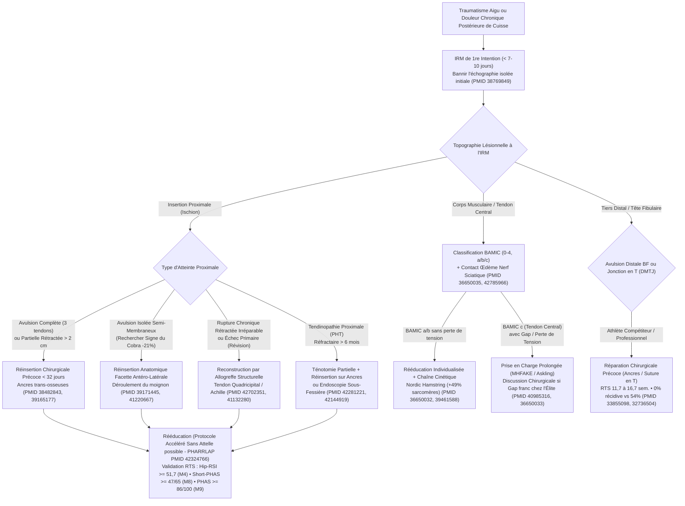

# Revue de la Littérature : Pathologie, Imagerie, Chirurgie et Rééducation des Ischio-Jambiers
**Synthèse Académique des 32 Publications de Référence du Portail [BiblioIschio](file:///Users/docteurlefevrenicolas/.gemini/antigravity/scratch/biblio-ischio/index.html) (2017–2026)**

> [!IMPORTANT]
> **Points Clés Transversaux de la Revue (32 études • > 4 200 patients analysés)**
> 1. **Urgence diagnostique (IRM 1re intention) :** Prescrire une IRM d'emblée plutôt qu'une échographie réduit de **10 jours** le délai opératoire médian (20 j vs 30 j) et améliore significativement les scores sportifs Tegner et UCLA à long terme ([Lefèvre et al., KSSTA 2024](https://pubmed.ncbi.nlm.nih.gov/38769849/)).
> 2. **Seuil critique de chronicité à 32 jours :** Au-delà de **32 jours** entre l'accident et la chirurgie, le risque de re-rupture est multiplié par **2,5** (`HR = 2,50`, $p = 0,01$) ([Lefèvre et al., AJSM 2024](https://pubmed.ncbi.nlm.nih.gov/38482843/)). À l'échelle méta-analytique ($n = 1\,720$), opérer avant 4 à 6 semaines réduit de **74 %** le risque de sciatalgie post-opératoire (`RR = 0,26`) et de **49 %** le risque de re-rupture (`RR = 0,51`) ([Akhtar et al., AJSM 2026](https://pubmed.ncbi.nlm.nih.gov/42358117/)).
> 3. **Supériorité démontrée de la chirurgie :** À plus de 4 ans de recul en analyse appariée par score de propension, la réinsertion chirurgicale multiplie par **6** (`OR = 6,04`) la probabilité de reprendre le sport au niveau antérieur (67,7 % vs 26,7 %) avec **89,5 %** de satisfaction contre **25 %** sous traitement conservateur ([Lefèvre et al., AJSM 2024](https://pubmed.ncbi.nlm.nih.gov/39165177/)).
> 4. **Sémiologie IRM spécifique :** Le **« Signe du Cobra »** possède une spécificité de **83,3 %** pour l'avulsion isolée du semi-membraneux et entraîne une surestimation radiologique moyenne de **21 % (2,0 cm)** de la rétraction réelle ([Lefèvre et al., KSSTA 2025](https://pubmed.ncbi.nlm.nih.gov/39171445/)).

---

## 🧭 Algorithme Décisionnel Intégré (Basé sur les 32 études)

---

## 1. Parcours Diagnostique, Sémiologie IRM et Classifications (6 études)

### 1.1. L'IRM en première intention : un impératif pronostique
Dans une étude portant sur **392 patients** opérés d'une avulsion proximale des ischio-jambiers entre 2012 et 2020 ([PMID 38769849](https://pubmed.ncbi.nlm.nih.gov/38769849/)), **Lefèvre et al. (*KSSTA*, 2024)** ont comparé le parcours débutant par une échographie (*US-first*) à celui débutant directement par une IRM (*MRI-first*) :
- Le délai médian entre l'accident et la chirurgie est réduit de **10 jours** dans le groupe IRM première : **20,0 jours** (`IQR 11–61`) contre **30,0 jours** (`IQR 18–74`) après échographie initiale.
- Ce gain temporel maintient les patients en deçà de la barrière critique des 32 jours et se traduit, à plus de 4 ans de recul, par des scores d'activité **Tegner** (médiane 5 vs 4) et **UCLA** significativement supérieurs.

### 1.2. Nouveaux signes IRM pré- et post-opératoires : « Signe du Cobra » et cicatrisation 3T
- **Le « Signe du Cobra » ([PMID 39171445](https://pubmed.ncbi.nlm.nih.gov/39171445/), Lefèvre et al., *KSSTA*, 2025) :** Sur une cohorte de **81 avulsions proximales opérées**, les auteurs ont individualisé un aspect IRM en bande hypo-T2 ondulée dont l'extrémité libre proximale se replie distalement sur elle-même, évoquant une tête de cobra dressée. Identifié chez 25 patients et confirmé chirurgicalement exclusivement dans les atteintes du **semi-membraneux**, ce signe affiche une **spécificité de 83,3 %** (sensibilité 51,5 %, rapport de vraisemblance positif `LR+ = 3,0`). Surtout, la mesure radiologique sur le sommet du pli surestime la rétraction réelle de **21 %** : **10,05 ± 3,0 cm** en IRM contre **7,9 ± 2,5 cm** mesurés en per-opératoire après déroulement du moignon (différence moyenne de **2,0 cm**, $p < 0,001$). Sa reconnaissance évite de récuser à tort une réinsertion primaire directe.
- **Cinétique IRM post-opératoire à 3 Tesla ([PMID 42963497](https://pubmed.ncbi.nlm.nih.gov/42963497/), Mechó, Lempainen, Kassarjian et al., *Skeletal Radiology*, 2026) :** L'analyse longitudinale de **43 IRM 3T** réalisées au cours des 4 premiers mois suivant une réparation complète chez **20 footballeurs professionnels** démontre que les fentes intra-tendineuses longitudinales (**73,3 %**) et transversales (**86,7 %**), l'angulation tendineuse (**100 %**) et l'œdème de dénervation musculaire (**66,7 %**) font partie du remodelage normal. À 4 mois, **~40 %** des tendons parfaitement cicatrisés et asymptomatiques gardent une fente résiduelle au sein d'un cal mature en hyposignal : seule l'association d'une cavité extensive en franc hypersignal DP-FatSat et d'une cicatrice immature prédit une rechute clinique.
- **Standardisation sémiologique ([PMID 42530617](https://pubmed.ncbi.nlm.nih.gov/42530617/), Weber et al., *Skeletal Radiology*, 2026) :** Souligne la dichotomie biomécanique et topographique entre les lésions de sprint haute vélocité (touchant préférentiellement la jonction myo-tendineuse et le tendon central du **chef long du biceps fémoral**) et les lésions par étirement forcé en flexion de hanche / extension de genou (*overstretch*, touchant le **semi-membraneux proximal**).

### 1.3. Consensus de Londres (Partie 1), Classification BAMIC et Nerf Sciatique
- **Consensus International de Londres — Partie 1 ([PMID 36650035](https://pubmed.ncbi.nlm.nih.gov/36650035/), Paton, Haddad et al., *BJSM*, 2023) :** Enquête Delphi réunissant **112 experts mondiaux** (88,4 % de réponse). La **BAMIC** (*British Athletics Muscle Injury Classification*, grades 0 à 4 et suffixes *a* myofascial, *b* myo-tendineux, *c* intra-tendineux) est la classification la plus utilisée (**58 %**), devant Munich (12 %) et Barcelone (6 %). Le panel recommande d'y adjoindre systématiquement le muscle précis atteint, le mécanisme lésionnel et la perte de tension tendineuse.
- **Spécificité clinique des lésions du tendon intramusculaire BAMIC *c* ([PMID 40985316](https://pubmed.ncbi.nlm.nih.gov/40985316/), Giakoumis, Pollock et al., *Scand J Med Sci Sports*, 2025) :** Chez l'athlète d'athlétisme d'élite, **30 %** des déchirures aiguës sont précédées dans les 7 jours par des lombalgies ou des crampes/raideurs postérieures. Les lésions intra-tendineuses de **classe *c*** présentent une EVA douleur plus élevée à la marche et à la contraction résistée, et mettent significativement plus de temps à tolérer le footing indolore ($p = 0,04$). La disparition de la douleur à la palpation ($p = 0,69$) ne prédit pas le délai de retour à l'entraînement complet (TRFT), contrairement au test d'extension active du genou à flexion maximale de hanche (**MHFAKE**, $p = 0,01$) et au **H-test d'Askling**.
- **Valeur pronostique de l'œdème péri-sciatique en IRM ([PMID 42785966](https://pubmed.ncbi.nlm.nih.gov/42785966/), Lee, Heiderscheit et al., *BJSM*, 2026) :** Sur **96 lésions aiguës** en football américain universitaire (NCAA Division I), l'œdème entre en contact avec le nerf sciatique dans **78,1 %** des cas (**36,5 %** de contact partiel, **41,7 %** d'engainement circonférentiel complet). L'engainement circonférentiel du nerf sciatique augmente significativement avec le grade BAMIC et constitue un facteur indépendant d'allongement du délai de retour au sport.

---

## 2. Ruptures Proximales Aiguës : Indications, Délai Optimal et Résultats de la Cohorte PHAS (7 études)

| Étude (Auteurs, Revue, Année) | PMID | Effectif & Design | Recul Moyen | Principaux Résultats Chiffrés |
| :--- | :--- | :--- | :--- | :--- |
| **Lefèvre et al.** (*OJSM*, 2026) | [`41918719`](https://pubmed.ncbi.nlm.nih.gov/41918719/) | $n = 757$ • Cohorte prospective PHAS | Suivi prospectif | Complications globales **10,4 %** (**5,6 %** re-ruptures, **4,7 %** hors re-rupture) ; **75 %** < 5,5 mois ; FdR : AT (`OR = 5,59`), SM isolé (`OR = 12,1`). |
| **Lefèvre et al.** (*OJSM*, 2026) | [`41685043`](https://pubmed.ncbi.nlm.nih.gov/41685043/) | $n = 139$ • Cohorte prospective (Niveau II) | **123,4 mois** (> 10 ans, min 8 ans) | **PHAS = 87,5 ± 14,9** ; UCLA de 3,1 à **7,5** ; amélioration continue du PHAS jusqu'à 8 ans ; chirurgie chronique (> 4 sem.) : **OR ~6** de mauvais PHAS. |
| **Akhtar et al.** (*AJSM*, 2026) | [`42358117`](https://pubmed.ncbi.nlm.nih.gov/42358117/) | $n = 1\,720$ (12 études : 992 précoces vs 728 différées) | 24 à 58,8 mois | Chirurgie précoce ($\le$ 4–6 sem.) : réduction des **sciatalgies (`RR = 0,26`, $p = 0,009$)** et des **re-ruptures (`RR = 0,51`, $p = 0,03$)**. |
| **Lefèvre et al.** (*KSSTA*, 2025) | [`39844676`](https://pubmed.ncbi.nlm.nih.gov/39844676/) | $n = 298$ appariés (< 50 ans vs > 50 ans) | 4,7 et 4,1 ans | Gain fonctionnel significatif avant (41,8 ans) et après 50 ans (58,0 ans) ; taux de complications et de retour au sport **identiques** ($p > 0,05$). |
| **Lefèvre et al.** (*AJSM*, 2024) | [`39165177`](https://pubmed.ncbi.nlm.nih.gov/39165177/) | $n = 127$ appariés (95 opérés vs 32 non opérés) | > 4 ans (50,7 vs 56,5 mois) | **PHAS 86,3 vs 69,8** ; RTS même niveau **67,7 % vs 26,7 % (`OR = 6,04`)** ; satisfaction **89,5 % vs 25 %**. |
| **Lefèvre et al.** (*AJSM*, 2024) | [`38482843`](https://pubmed.ncbi.nlm.nih.gov/38482843/) | $n = 740$ • Cohorte PHAS | 4,9 ± 3,9 ans | Taux de re-rupture **4,59 %** (médiane 88,5 j, 74 % atraumatiques) ; **seuil ROC optimal = 32 jours (`HR = 2,50`)** ; rupture complète initiale (`HR = 4,33`). |
| **Lefèvre et al.** (*AJSM*, 2024) | [`38353018`](https://pubmed.ncbi.nlm.nih.gov/38353018/) | $n = 64$ athlètes professionnels | Série prospective | **RTS global = 98,4 %** ; RTS au niveau pro antérieur = **78,1 % à 6,2 ± 2,5 mois** (football 95,2 %, handball/escrime 100 %). |

### 2.1. Supériorité du traitement chirurgical et absence de limite d'âge à 50 ans
L'étude comparative appariée par score de propension ([PMID 39165177](https://pubmed.ncbi.nlm.nih.gov/39165177/)) apporte la preuve directe que chez les patients présentant une avulsion complète ou partielle rétractée $> 2\text{ cm}$, le refus de la chirurgie expose à un déficit fonctionnel majeur à plus de 4 ans (satisfaction de seulement **25 %** contre **89,5 %** après réinsertion sur ancres). De plus, l'appariement de **298 patients** de part et d'autre du seuil de 50 ans ([PMID 39844676](https://pubmed.ncbi.nlm.nih.gov/39844676/)) démontre que les patients quinquagénaires et sexagénaires actifs bénéficient d'une récupération fonctionnelle et d'un retour au sport comparables aux sujets jeunes, sans sur-risque de complication.

### 2.2. La règle des 32 jours et le profil des complications sur 757 patients
L'analyse conjointe des deux grandes séries de la cohorte PHAS ($n = 740$ dans [PMID 38482843](https://pubmed.ncbi.nlm.nih.gov/38482843/) et $n = 757$ dans [PMID 41918719](https://pubmed.ncbi.nlm.nih.gov/41918719/)) et de la méta-analyse d'Akhtar et al. ([PMID 42358117](https://pubmed.ncbi.nlm.nih.gov/42358117/)) établit trois lois chirurgicales majeures :
1. **La fenêtre optimale de 32 jours :** La courbe ROC identifie à **32 jours** la frontière exacte au-delà de laquelle l'incidence des re-ruptures s'élève significativement (`HR = 2,50`, IC 95 % `1,24–5,06`).
2. **La période de vulnérabilité post-opératoire (0–6 mois) :** **75 %** des re-ruptures (médiane **88,5 jours**) et **75 %** des complications globales surviennent durant les **5,5 à 6 premiers mois**, et **74 %** des re-ruptures surviennent sans nouveau traumatisme franc.
3. **Les résultats chez l'athlète professionnel ([PMID 38353018](https://pubmed.ncbi.nlm.nih.gov/38353018/)) :** Chez 64 sportifs professionnels, les ruptures complètes du tendon libre proximal sans avulsion de l'empreinte osseuse (*negative dropped ice cream sign*, PHTR) récupèrent nettement plus vite (`HR = 7,77`) que les avulsions tubérositaires vraies (*positive dropped ice cream sign*).

---

## 3. Ruptures Chroniques, Chirurgie de Révision et Reconstructions par Allogreffe (4 études)

Lorsque le diagnostic a été méconnu ou en cas de re-rupture post-opératoire, la rétraction tendineuse et la fibrose péri-sciatique transforment le pronostic et la technique :
- **Chirurgie de révision vs réparation primaire ([PMID 40815844](https://pubmed.ncbi.nlm.nih.gov/40815844/), Lefèvre et al., *AJSM*, 2025) :** Dans une étude cas-témoins appariée 1:4 (**32 révisions vs 128 réparations primaires**, recul ~4 ans), le recours à une allogreffe est quatre fois plus fréquent lors d'une reprise (**37,5 % vs 9,4 %**, $p = 0,0003$). Si le score PHAS médian reste bon chez les patients consolidés (**85,0 vs 91,5**, $p = 0,01$), le taux de re-rupture itérative atteint **31,3 %** en révision contre **3,9 %** en primaire, soit un risque multiplié par 8 (`HR = 8,19`, IC 95 % `2,76–24,3`).
- **Reconstruction par allogreffe structurelle ([PMID 42702351](https://pubmed.ncbi.nlm.nih.gov/42702351/), Lefèvre et al., *Arthroscopy*, 2026) :** Sur **42 patients** présentant une avulsion chronique irréparable directement (suivi moyen **3,4 ± 1,6 ans**), l'interposition d'une allogreffe structurelle fait bondir le score PHAS médian de **56,3** (`IQR 49,0–64,0`) à **84,5** (`IQR 73,8–94,8`), avec **56,4 %** des patients franchissant le seuil exigeant du *Patient Acceptable Symptom State* (`PASS > 82,3`), bien que le retour au sport intensif pré-lésionnel demeure limité.
- **Note technique d'allogreffe quadricipitale ([PMID 41132280](https://pubmed.ncbi.nlm.nih.gov/41132280/), Lefèvre et al., *Arthrosc Tech*, 2025) :** Décrit le pontage des grandes rétractions chroniques par une **allogreffe fraîche congelée de tendon quadricipital** : l'extrémité proximale épaisse est solidement ancrée sur l'ischion tandis que l'éventail distal enveloppe le moignon rétracté, évitant d'immobiliser le genou en flexion forcée.
- **Note technique pour le semi-membraneux isolé ([PMID 41220667](https://pubmed.ncbi.nlm.nih.gov/41220667/), Lefèvre et al., *Arthrosc Tech*, 2025) :** Systématise l'abord de la facette antéro-latérale de la tubérosité ischiatique, le déroulement per-opératoire du moignon en « tête de cobra » et sa réinsertion anatomique par ancres.

---

## 4. Tendinopathie Proximale Chronique (PHT), Endoscopie et Consensus Chirurgical (4 études)

- **Ténotomie partielle et réinsertion pour PHT réfractaire ([PMID 42281221](https://pubmed.ncbi.nlm.nih.gov/42281221/), Lefèvre et al., *AJSM*, 2026) :** Chez **42 patients** (âge moyen 50,4 ans, suivi moyen **4,1 ans** jusqu'à 12,6 ans) souffrant d'une tendinopathie proximale chronique rebelle à plus de 6 mois de traitement conservateur, l'excision des zones de tendinose fissuraire associée à une réinsertion sur ancres fait progresser le score PHAS moyen de **63,0 ± 11,4 à 84,2 ± 18,2** ($p < 0,001$), avec un haut niveau de satisfaction et de reprise sportive.
- **Résultats à long terme de la réparation endoscopique ([PMID 42144919](https://pubmed.ncbi.nlm.nih.gov/42144919/), Greenwood et al., *Arthroscopy*, 2026) :** Avec un recul moyen de **7,6 ans** (minimum 6,2 ans, maximum 10,6 ans), la réparation endoscopique de l'espace sous-fessier profond maintient d'excellents scores (mHHS **82,6**, HOS-Sports **89,2/100**, EVA douleur **1,7/10**), **86,4 %** de satisfaction et **85,7 %** de patients au-dessus du seuil PASS pour les lésions partielles ou peu rétractées.
- **Consensus International de Londres — Partie 2 : Prise en charge chirurgicale ([PMID 36650033](https://pubmed.ncbi.nlm.nih.gov/36650033/), Plastow, Kerkhoffs, Haddad et al., *BJSM*, 2023) :** Valide à l'échelle internationale trois indications opératoires formelles :
  1. L'écart inter-fragmentaire (*gapping*) avec **perte de tension** de l'unité musculo-tendineuse (**87,2 %** d'accord) ;
  2. Les avulsions osseuses déplacées symptomatiques (**72,8 %**) ;
  3. Les lésions du tendon libre proximal avec déficit fonctionnel résistant au traitement non chirurgical (**72,2 %**).
  Le panel déconseille formellement les infiltrations de corticoïdes dans les lésions aiguës.

---

## 5. Ruptures Distales et Lésions de la Jonction en T (DMTJ) du Biceps Fémoral (3 études)

Le tiers distal de la loge postérieure comporte deux entités à très haut risque de séquelles fonctionnelles ou de récidive chez le sportif :
1. **La jonction musculo-tendineuse distale en T (DMTJ) du biceps fémoral :**
   - **Histoire naturelle et sémiologie IRM ([PMID 28795071](https://pubmed.ncbi.nlm.nih.gov/28795071/), Entwisle, Brukner, Connell et al., *OJSM*, 2017) :** L'analyse de **106 IRM** montre que la confluence aponévrotique en « T » entre le chef long (51 % d'atteinte isolée) et le chef court (43 % d'atteinte combinée des deux chefs), soumise à une double innervation (tibiale et fibulaire), présente un **taux de récidive de 54 %** sous traitement conservateur, dont **76 %** dans les 3 premiers mois et **86 %** avec une gravité égale ou supérieure.
   - **Réparation chirurgicale de la jonction en T ([PMID 32736504](https://pubmed.ncbi.nlm.nih.gov/32736504/), Kayani, Haddad et al., *AJSM*, 2020) :** Chez **34 athlètes professionnels** opérés en aigu par suture anatomique et remise en tension de la jonction en T, **100 %** sont revenus à leur niveau sportif antérieur en **11,7 ± 3,6 semaines** avec **0 % de récidive** à 28,4 mois de suivi moyen.
2. **Les avulsions distales du tendon du biceps fémoral ([PMID 33855098](https://pubmed.ncbi.nlm.nih.gov/33855098/), Thompson, Plastow, Haddad et al., *OJSM*, 2021) :** Chez **22 sportifs professionnels** (football, rugby) opérés précocement (moyenne J12) par réinsertion sur ancres à la tête fibulaire avec neurolyse protectrice du nerf fibulaire commun, **100 %** ont repris la compétition au niveau pré-lésionnel en **16,7 ± 8,7 semaines** sans aucune récidive à 2 ans.

---

## 6. Scores Cliniques (PHAS, Short-PHAS, Hip-RSI), Rééducation et Prévention (6 études)

### 6.1. La triade d'évaluation validée par l'école parisienne : PHAS, Short-PHAS et Hip-RSI
| Score | Publication & PMID | Population Validée | Fidélité & Corrélation | Seuils Prédictifs de Retour au Sport (RTS) |
| :--- | :--- | :--- | :--- | :--- |
| **PHAS** (36 items / 100 pts) | [Lefèvre et al., *AJSM* 2024 (`38353118`)](https://pubmed.ncbi.nlm.nih.gov/38353118/) | $n = 156$ (suivi moyen 69 mois) | Cronbach $\alpha = 0,86$ • **ICC = 0,96** • MDC = 12,9 • Aucun effet plafond | **PHAS $\ge$ 86/100 à 9 mois** prédit le RTS à 1 an (Spécificité **81,4 %**, Sensibilité **65,6 %**, `AUC > 0,70`). |
| **Short-PHAS** (12 items / 65 pts) | [Kassab Hassan, Lefèvre et al., *OJSM* 2026 (`42169801`)](https://pubmed.ncbi.nlm.nih.gov/42169801/) | $n = 335$ (âge moyen 48 ± 10 ans) | Cronbach $\alpha = 0,85$ • Corrélation avec PHAS long **$r = 0,94$** | À 8 mois : **39/65** (RTS global, `AUC = 0,75`), **46/65** (même sport), **47/65** (niveau pré-lésionnel, `AUC = 0,75`). |
| **Hip-RSI** (Psychologique / 100 pts) | [Hadjam, Lefèvre et al., *OJSM* 2025 (`41306750`)](https://pubmed.ncbi.nlm.nih.gov/41306750/) | $n = 84$ (évalués à M4 et M9) | **ICC = 0,89** • Corrélation PHAS $r = 0,55$ • Cronbach $\alpha = 0,97$ | **Hip-RSI $\ge$ 51,7/100 à 4 mois** prédit le retour au sport antérieur à 9 mois (Spécificité **77 %**, Sensibilité **69 %**, `AUC = 0,76`). |

### 6.2. Rééducation post-opératoire accélérée (Essai PHARRLAP) et Consensus de Londres (Partie 3)
- **Essai contrôlé randomisé PHARRLAP de Niveau I ([PMID 42324766](https://pubmed.ncbi.nlm.nih.gov/42324766/), Ebert et al., *AJSM*, 2026) :** Compare chez 57 patients opérés en aigu ($\ge 2$ tendons avulsés) un protocole conservateur (**6 semaines d'attelle de genou et appui restreint**, $n = 30$) à un protocole accéléré (**aucune attelle et appui complet immédiat selon tolérance**, $n = 27$). Le groupe accéléré présente significativement moins de douleurs à 3 mois ($p = 0,034$) et 12 mois ($p = 0,010$), un meilleur score physique SF-12 à 3 mois ($p = 0,039$), et une symétrie isocinétique des fléchisseurs (PKFT) et des hop-tests strictement identique à 6, 12 et 24 mois, sans différence sur le taux de re-rupture (2 cas dans chaque bras sur 2 ans).
- **Preuve in vivo de l'addition de sarcomères en série par le Nordic Hamstring ([PMID 39461588](https://pubmed.ncbi.nlm.nih.gov/39461588/), Andrews, Delp et al., *J Sport Health Sci*, 2025) :** Grâce à la micro-endoscopie par seconde harmonique couplée à l'IRM et l'échographie 3D, les auteurs démontrent que 9 semaines d'entraînement en *Nordic Hamstring Exercise* (NHE) augmentent la force excentrique de **+40 %** et allongent les fascicules du chef long du biceps fémoral de **+19 %** au centre et **+33 %** en distal par **addition réelle de sarcomères en série (+25 % au centre et +49 % en distal)**. Point crucial : 3 semaines d'arrêt (*detraining*) suffisent à perdre **12 % à 16 %** de longueur fasciculaire, prouvant la nécessité d'un entretien hebdomadaire permanent en saison.
- **Consensus International de Londres — Partie 3 ([PMID 36650032](https://pubmed.ncbi.nlm.nih.gov/36650032/), Paton, van Dyk, Haddad et al., *BJSM*, 2023) :** Établit la nécessité d'intégrer la chaîne cinétique lombo-pelvienne (**95 %** d'accord), de combiner les exercices à dominante hanche et genou, et d'exiger un **sprint maximal strictement indolore (85,5 % d'accord)** avant toute reprise de la compétition.

---

## 7. Ischio-Jambiers et Plastie du LCA : Morbidité du Prélèvement et Préservation de l'Insertion Tibiale (2 études)

- **Rétraction anatomique définitive du semi-tendineux après prélèvement DIDT ([PMID 34471958](https://pubmed.ncbi.nlm.nih.gov/34471958/), Speedtsberg, Hölmich et al., *KSSTA*, 2022) :** À **6,8 ans** de recul moyen après plastie du LCA par autogreffe semi-tendineux/gracilis, l'IRM bilatérale comparative montre un raccourcissement proximal moyen de **81 mm (soit -25 % de longueur musculaire)** du semi-tendineux par rapport au membre sain (où la variation naturelle inter-membre est toujours $< 10\text{ mm}$). Cette rétraction myo-tendineuse explique le déficit persistant de couple de flexion active aux angles élevés ($> 70\text{–}90^\circ$).
- **Essai randomisé sur la préservation de l'insertion tibiale (*Attachment-Sparing*) ([PMID 42310826](https://pubmed.ncbi.nlm.nih.gov/42310826/), Sinha et al., *AJSM*, 2026) :** Dans cet essai contrôlé randomisé de Niveau I ($n = 56$) avec IRM séquentielles à 3, 6 et 9 mois, conserver l'attache distale des tendons ischio-jambiers sur la patte d'oie lors de la reconstruction du LCA supprime le gonflement œdémateux initial du greffon et accélère significativement sa ligamentisation : **100 %** des greffons pédiculés atteignent le score IRM maximal de maturation (**Figueroa 5/5**) à 9 mois contre seulement **10 %** des greffons libres ($p < 0,001$).

---

## 📚 Index Complet des 32 Références Bibliographiques

1. **Lefèvre N**, Moussa MK, Valentin E, Freiha K, Bohu Y, Gerometta A, Khiami F, Grimaud O, Meyer A, Hardy A. *Risk Factors for Complications After Proximal Hamstring Avulsion Injury: Analysis of 757 Patients From the PHAS Cohort.* **Orthop J Sports Med**. 2026. [PMID: 41918719](https://pubmed.ncbi.nlm.nih.gov/41918719/)
2. **Lefèvre N**, Moussa MK, Nouira Z, Valentin E, Bohu Y, Gerometta A, Khiami F, Meyer A, Grimaud O, Hardy A. *Long-term Outcomes and Return to Sport After Surgical Repair of Proximal Hamstring Avulsions: A ≥8-Year Follow-up Study.* **Orthop J Sports Med**. 2026. [PMID: 41685043](https://pubmed.ncbi.nlm.nih.gov/41685043/)
3. **Akhtar M**, Ramanis M, Pasko K, Wang D. *Early Versus Delayed Repair of Proximal Hamstring Tendon Ruptures: A Systematic Review and Meta-analysis.* **Am J Sports Med**. 2026. [PMID: 42358117](https://pubmed.ncbi.nlm.nih.gov/42358117/)
4. **Lefèvre N**, Moussa MK, Alban Bouché P, Valentin E, Gerometta A, Khiami F, Grimaud O, Meyer A, Bohu Y, Hardy A. *Improved outcomes of proximal hamstring avulsion surgery in patients both under and over 50 years, with greater gains in the younger group: A matched comparative study of the PHAS cohort.* **Knee Surg Sports Traumatol Arthrosc**. 2025. [PMID: 39844676](https://pubmed.ncbi.nlm.nih.gov/39844676/)
5. **Lefèvre N**, Moussa MK, El Otmani L, Valentin E, Meyer A, Grimaud O, Bohu Y, Hardy A. *Surgical Treatment of Proximal Hamstring Avulsion Injuries Compared With Nonsurgical Treatment: A Matched Comparative Study With a Mean Follow-up of >4 Years From the Proximal Hamstring Avulsion Surgery Cohort Study.* **Am J Sports Med**. 2024. [PMID: 39165177](https://pubmed.ncbi.nlm.nih.gov/39165177/)
6. **Lefèvre N**, Freiha K, Moussa MK, Valentin E, Bohu Y, Meyer A, Hardy A. *Risk Factors for Rerupture After Proximal Hamstring Avulsion Injury Including the Optimal Timing for Surgery.* **Am J Sports Med**. 2024. [PMID: 38482843](https://pubmed.ncbi.nlm.nih.gov/38482843/)
7. **Lefèvre N**, Moussa MK, Valentin E, Meyer A, Bohu Y, Gerometta A, Khiami F, Grimaud O, Khalaf Z, Hardy A. *Predictors of Early Return to Sport After Surgical Repair of Proximal Hamstring Complex Injuries in Professional Athletes: A Prospective Study.* **Am J Sports Med**. 2024. [PMID: 38353018](https://pubmed.ncbi.nlm.nih.gov/38353018/)
8. **Lefèvre N**, Moussa MK, Valentin E, Bohu Y, Gerometta A, Khiami F, Meyer A, Grimaud O, Hardy A. *Structural Allograft Reconstruction for Chronic Proximal Hamstring Avulsion Yields Significant Functional Improvement, Acceptable Satisfaction, but Limited Return to Preinjury Sport Levels.* **Arthroscopy**. 2026. [PMID: 42702351](https://pubmed.ncbi.nlm.nih.gov/42702351/)
9. **Lefèvre N**, Moussa MK, Orso A, Valentin E, Bohu Y, Gerometta A, Khiami F, Grimaud O, Meyer A, Hardy A. *Outcomes of Revision Versus Primary Repair of Proximal Hamstring Avulsion Injury.* **Am J Sports Med**. 2025. [PMID: 40815844](https://pubmed.ncbi.nlm.nih.gov/40815844/)
10. **Lefèvre N**, Sezer HB, Alayane A, Fares A, Moussa MK, Hardy A. *Reconstruction of Chronic Proximal Hamstring Avulsion Injury Using Quadriceps Allograft: A Technical Note.* **Arthrosc Tech**. 2025. [PMID: 41132280](https://pubmed.ncbi.nlm.nih.gov/41132280/)
11. **Lefèvre N**, Alayane A, Moussa MK, Bohu Y, Meyer A, Hardy A. *Anatomic Reinsertion of Isolated Proximal Semimembranosus Tendon Avulsion in Athletic Population: A Technical Note.* **Arthrosc Tech**. 2025. [PMID: 41220667](https://pubmed.ncbi.nlm.nih.gov/41220667/)
12. **Mechó S**, Pérez P, Congo A, et al. *Temporal MRI appearance of postoperative healing after proximal hamstring musculotendinous complex repair.* **Skeletal Radiol**. 2026. [PMID: 42963497](https://pubmed.ncbi.nlm.nih.gov/42963497/)
13. **Weber MA**, Randow M, Klaan B. *Imaging characterization of sports-related hamstring injuries.* **Skeletal Radiol**. 2026. [PMID: 42530617](https://pubmed.ncbi.nlm.nih.gov/42530617/)
14. **Lefèvre N**, Moussa MK, Chahal A, Meyer A, Grimaud O, Khalaf ZM, Alayane A, Bohu Y, Hardy A. *The Cobra sign: A marker for overestimation of tendon retraction in proximal semimembranosus tendon avulsion.* **Knee Surg Sports Traumatol Arthrosc**. 2025. [PMID: 39171445](https://pubmed.ncbi.nlm.nih.gov/39171445/)
15. **Lefèvre N**, Coughlan A, Valentin E, Sezer HB, Bohu Y, Moussa MK, Hardy A. *Magnetic resonance imaging should be the first-line imaging modality for investigating suspected proximal hamstring avulsion injuries.* **Knee Surg Sports Traumatol Arthrosc**. 2024. [PMID: 38769849](https://pubmed.ncbi.nlm.nih.gov/38769849/)
16. **Giakoumis M**, Kelly S, Lee J, Stone B, Polglass G, Brown J, MacDonald B, Pollock N. *Clinical Presentation and Rehabilitation Progression Following Hamstring Injury Assessed by BAMIC in Elite Track and Field.* **Scand J Med Sci Sports**. 2025. [PMID: 40985316](https://pubmed.ncbi.nlm.nih.gov/40985316/)
17. **Paton BM**, Court N, Giakoumis M, et al. *London International Consensus and Delphi study on hamstring injuries part 1: classification.* **Br J Sports Med**. 2023. [PMID: 36650035](https://pubmed.ncbi.nlm.nih.gov/36650035/)
18. **Lefèvre N**, Moussa MK, Valentin E, Hadjam T, Gerometta A, Grimaud O, Meyer A, Bohu Y, Khiami F, Hardy A. *Partial Tenotomy and Reattachment for Chronic Proximal Hamstring Tendinopathy: Functional Outcomes, Return to Sport, and Patient Satisfaction.* **Am J Sports Med**. 2026. [PMID: 42281221](https://pubmed.ncbi.nlm.nih.gov/42281221/)
19. **Greenwood SN**, Adebayo T, Reinke EK, Fletcher AN, Lewis BD, Scott EJ, Mather RC. *Endoscopic Proximal Hamstring Repairs Remain Safe and Beneficial With High Patient Satisfaction at a Minimum of 6-Year Follow-Up.* **Arthroscopy**. 2026. [PMID: 42144919](https://pubmed.ncbi.nlm.nih.gov/42144919/)
20. **Lee KS**, Miller A, Mosiman S, Joachim MR, Heiderscheit B. *Sciatic nerve involvement is associated with longer return to sport in collegiate American football players with acute hamstring injuries.* **Br J Sports Med**. 2026. [PMID: 42785966](https://pubmed.ncbi.nlm.nih.gov/42785966/)
21. **Plastow R**, Kerkhoffs GMMJ, Wood D, et al. *London International Consensus and Delphi study on hamstring injuries part 2: operative management.* **Br J Sports Med**. 2023. [PMID: 36650033](https://pubmed.ncbi.nlm.nih.gov/36650033/)
22. **Thompson JW**, Plastow R, Kayani B, Moriarty P, Asokan A, Haddad FS. *Surgical Repair of Distal Biceps Femoris Avulsion Injuries in Professional Athletes.* **Orthop J Sports Med**. 2021. [PMID: 33855098](https://pubmed.ncbi.nlm.nih.gov/33855098/)
23. **Kayani B**, Ayuob A, Begum F, Singh S, Haddad FS. *Surgical Repair of Distal Musculotendinous T Junction Injuries of the Biceps Femoris.* **Am J Sports Med**. 2020. [PMID: 32736504](https://pubmed.ncbi.nlm.nih.gov/32736504/)
24. **Entwisle T**, Ling Y, Splatt A, Brukner P, Connell D. *Distal Musculotendinous T Junction Injuries of the Biceps Femoris: An MRI Case Review.* **Orthop J Sports Med**. 2017. [PMID: 28795071](https://pubmed.ncbi.nlm.nih.gov/28795071/)
25. **Kassab Hassan S**, Rougereau G, Moussa M, Khiami F, Gerometta A, **Lefèvre N**, Hardy A. *Development and Validation of a Short Version of the Parisian Hamstring Avulsion Score (PHAS): The Short PHAS.* **Orthop J Sports Med**. 2026. [PMID: 42169801](https://pubmed.ncbi.nlm.nih.gov/42169801/)
26. **Hadjam T**, Lacombe-Ossó J, Valentin E, Moussa MK, **Lefèvre N**, Hardy A. *The Hip-RSI Score for Evaluating Psychological Readiness to Return to Sport After Surgical Repair of a Proximal Hamstring Avulsion.* **Orthop J Sports Med**. 2025. [PMID: 41306750](https://pubmed.ncbi.nlm.nih.gov/41306750/)
27. **Lefèvre N**, Kassab Hassan S, Valentin E, Bohu Y, Gerometta A, Meyer A, Grimaud O, Hardy A. *Validation of the Parisian Hamstring Avulsion Score (PHAS) in the Evaluation and Follow-up of Patients Operated for Proximal Hamstring Avulsion.* **Am J Sports Med**. 2024. [PMID: 38353118](https://pubmed.ncbi.nlm.nih.gov/38353118/)
28. **Ebert JR**, Edwards PK, Cecchi S, Malik SS, Aujla RS, Ricciardo B, Annear P, D'Alessandro PA. *Two-Year Outcomes of the Proximal Hamstring Avulsion Rehabilitation Regimes: Longitudinal Versus Accelerated Protocol (PHARRLAP) Study: A Randomized Controlled Trial.* **Am J Sports Med**. 2026. [PMID: 42324766](https://pubmed.ncbi.nlm.nih.gov/42324766/)
29. **Andrews MH**, S AP, Gurchiek RD, Pincheira PA, Chaudhari AS, Hodges PW, Lichtwark GA, Delp SL. *Multiscale hamstring muscle adaptations following 9 weeks of eccentric training.* **J Sport Health Sci**. 2025. [PMID: 39461588](https://pubmed.ncbi.nlm.nih.gov/39461588/)
30. **Paton BM**, Read P, van Dyk N, et al. *London International Consensus and Delphi study on hamstring injuries part 3: rehabilitation, running and return to sport.* **Br J Sports Med**. 2023. [PMID: 36650032](https://pubmed.ncbi.nlm.nih.gov/36650032/)
31. **Sinha S**, Arumugham KC, Singh DK, Kumar N, Bera AP, Uppal H, Vakharia KS. *ACL Reconstruction With Attachment-Sparing Hamstring Autograft Results in Earlier Graft Maturation and Better Short-Term Clinical Outcome in Comparison to Free Graft: A Randomized Controlled Trial.* **Am J Sports Med**. 2026. [PMID: 42310826](https://pubmed.ncbi.nlm.nih.gov/42310826/)
32. **Speedtsberg MB**, Zebis MK, Lauridsen HB, Magnussen E, Hölmich P. *Anatomical retraction of the semitendinosus muscle following harvest of the distal semitendinosus tendon for ACL reconstruction.* **Knee Surg Sports Traumatol Arthrosc**. 2022. [PMID: 34471958](https://pubmed.ncbi.nlm.nih.gov/34471958/)
